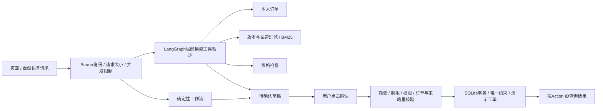

# Aftercare · 售后决策与工单工作台

[](https://github.com/solamn-1042/aftercare-agent-demo/actions/workflows/verify.yml)

面向“商品坏了，能不能申请售后”的可运行工程展示：查询本人订单、检索正确版本的政策、判断申请条件、生成待确认草稿，再由用户明确确认创建演示工单。模型负责选择查询动作；权限、资格、确认、幂等和最终业务状态由代码控制。

这是 AI 辅助开发的个人项目，所有商店规则与订单均为合成数据。没有真实客户、退款支付、生产流量或经营收益数据。当前提供可复现的离线评测和故障注入，不冒充企业线上案例。


## 先看什么

- [三分钟演示脚本](docs/DEMO.md)：正常申请、超期、越权、重复确认、重启恢复。
- [项目讲解与面试问答](docs/INTERVIEW.md)：HR版、技术版、选型取舍、失败案例与追问证据。
- [场景—技术—优化—测试映射](docs/DECISIONS.md)：指南各主题在项目里的实现位置和限制。
- [完整检索实验](evals/lab_report.json)、[真实模型评测](evals/lab_agent.json)、[首轮模型记录](evals/baseline/lab_agent.json)。

## 五分钟启动（推荐 v2 工作台）

Python 3.12。v2 的范围过滤检索使用轻量 BM25，首次运行不下载向量模型；没有模型密钥时仍可完成结构化业务演示。自然语言 Agent 需要配置自己的兼容模型服务。

```powershell
python -m venv .venv
.venv\Scripts\Activate.ps1
python -m pip install -r requirements-lab.txt
Copy-Item .env.example .env
python -c "import secrets; print(secrets.token_urlsafe(32))"
# 把随机串写入 .env 的 API_TOKEN；可选填写模型配置
python -m uvicorn lab.app:app --env-file .env --host 127.0.0.1 --port 8001 --workers 1
```

打开 http://127.0.0.1:8001 ，在页面输入 API_TOKEN。不要把示例令牌用于公网。Linux 使用 `source .venv/bin/activate` 和 `cp .env.example .env`。

订单 A001：Alice 的耳机，当前可申请；A002：Alice 的旧键盘，超时限；A003：Alice 的显示器，运输破损需照片人工核验；B001：Bob 的订单，Alice 被拒绝。**演示业务日期固定为2026-11-14**，不自动随今天日期改变。

```sh
docker compose -f compose.lab.yaml up --build -d
docker compose -f compose.lab.yaml logs --tail 30
```

Docker 使用非root、只读根文件系统和独立SQLite数据卷，仅监听本机。`.env`、数据库、会话、访问令牌和模型密钥不提交Git。v2不支持公网多租户或分布式多副本。

## 请求如何完成



模型工具仅4个：`read_order`、`find_policy`、`check_eligibility`、`prepare_draft`。确认提交不暴露给模型。草稿有效期15分钟；确认绑定参数摘要、策略指纹、Schema版本和订单修订号。重复确认返回原工单；同一订单同一问题类型在Demo内仅允许一张工单，区别于支持多次售后的真实业务。

会话只保存已确认订单，不保存无限聊天历史，也不声称长期Memory。模型循环最多4次调用、6次唯一工具调用、每轮2个工具、20秒调用前截止预算和每次最多8秒模型请求超时；单次最大输出500 Token。没有价格级费用硬预算或自动切换供应商。

## 可复现实验

数据为240条公开政策（8商品×3渠道×5主题×2版本）+8条内部ACL探针。252个问题中，150条用于开发，90条按商品族留出做有答案测试，12条无答案探针单独记录。生成脚本公开，但没有独立标注人员，不能称作第三方盲测。

实验只改变“是否按订单元数据预过滤”；两边均保留公开资料ACL，使用同一BM25、同一Top-3和同一语料。全库基线代表未处理版本/渠道适用性的实现，不能据此声称优于成熟RAG系统。新工作流没有虚构Reranker收益。

| 检查项 | 基线 | 本次结果 | 口径 |
|---|---:|---:|---|
| 留出集 Hit@3 | 30.0% | 90.0% | 90条有答案题，精确匹配适用政策ID |
| 留出集 Hit@1 | 6.7% | 56.7% | 同一批问题，排序器均为BM25 |
| MRR@3 | 0.163 | 0.717 | 未命中记0 |
| Top-3适用范围错误片段 | 225 | 0 | 商品/渠道/购买日期任一不匹配 |
| 留出集检索P95 | 1.691 ms | 0.118 ms | 本机CPU，未包含模型/网络 |
| 重复查询平均耗时 | 0.053 ms | 0.027 ms | 100次微基准，缓存热命中99次，证据一致 |
| 模型业务状态检查 | — | 24/24 | 8个任务各3次，仅检查草稿与未确认不写入 |
| 模型完整响应平均/P95 | — | 3.94/5.92 秒 | DeepSeek deepseek-v4-flash，串行真实调用 |
| 全量自动回归 | 原有31项 | 57项通过 | 旧服务31 + 新检索/工作流/HTTP/Agent26 |

结果仍有9条留出问题未命中，主要是“不开机”“银行卡里”等口语与政策词汇不匹配。Hit@1只有56.7%，Top-3还会带入不相关主题。12条无答案探针有4条返回候选，候选不等于可回答；目前未完成独立语义评分或可校准的拒答阈值。

```sh
python -m lab.evaluate
python -m unittest discover -s tests -p 'test_lab*.py' -v
# 显式加载你自己的 .env 后，执行24次真实模型评测；会产生API费用
python -c "from dotenv import load_dotenv; load_dotenv(); from lab.evaluate_agent import main; main()"
```

`lab.build_data`可重建合成数据；测试用例与语料指纹在报告中，改数据后应新建评测版本，而非用新分母覆盖旧结果。缓存基准不是原v1的1.90秒端到端优化。v2多步任务平均约3.94秒，业务更复杂，不能跨任务集宣称加速。

## 实际失败与修复

1. 检索拿到同商品的其他渠道或旧版本。固定问题和排序器后先过滤适用范围，留出集范围错误片段225→0；仍保留口语召回失败，见`lab_report.json`。
2. 首轮真实模型让用户在页面上传照片，但页面没有上传能力。结构化状态评分24/24没有发现该错误。通过工具返回的业务状态约束最终回复、明确人工渠道，加回归后同一组任务复测；首轮记录没有删除。
3. 注入“数据库已提交、响应丢失”：第一次调用抛超时，按Action ID查询得到成功；重复确认返回同一工单。8个并发确认、不同草稿相同业务请求也验证不会重复创建。此项是本地故障注入，不是真实生产事故，更不代表验证了外部退款网络。

## 验证层次与展示

- 自动回归57项覆盖旧服务和v2；新增26项包括跨用户访问、确认到期、策略变更、重启恢复、取消、并发幂等、响应丢失、Schema注入和能力越界。
- 真实HTTP验证健康200、无认证401、越权409、提交与重复提交同一工单号；见`evals/lab_http_smoke.json`。
- Edge页面实际操作：连接→资格检查→检索对照→草稿→确认→重复确认→越权。截图来自真实页面，不是设计稿。
- CI保留原回归/Embedding容器检查，新增轻量工作台测试、检索实验、Docker构建和容器内HTTP工单流程。模型密钥不进入CI；以对应提交Actions结果为准。

## 运行、回滚与边界

- v2默认SQLite路径为`var/cases.sqlite3`，可用`CASE_DB`覆盖；启动时使用`CREATE TABLE IF NOT EXISTS`，当前无复杂Schema迁移工具。
- 升级前停止服务并备份数据库，再记录代码版本与政策指纹；回滚要同时恢复匹配的数据快照。确认期间索引版本发生变化会使旧草稿失效，需重新核验。
- Bearer只映射到固定`demo-alice`，业务层另有owner检查。内部文档在所有检索路径均被排除；订单数据从不进入公共检索缓存。
- 模型Trace只持久化节点、调用ID、状态和耗时，不保存私有思维链或完整Prompt；模型运行记录保留7天并在写入时清理。工单/草稿包含用户问题描述，当前没有自动删除策略，仅可使用合成数据；生产需要敏感信息治理和业务保留制度。
- SQLite事务覆盖本地工单创建与动作状态；不适用于外部支付的分布式一致性。没有支付、照片上传、消息通知、真实人工转接、生产SLA、长期Memory、模型网关或多Agent。
- 当前检索单独对照了范围过滤与BM25，v1的BGE/Chroma仍在旧服务中。两条实验没有混合计算效果，后续应在同一v2数据集上对比向量/混合/Reranker，不能直接沿用v1的40/40结论。

## 目录与旧版本

`lab/workflow.py`：业务状态与幂等；`lab/retrieval.py`：索引、过滤、BM25、缓存；`lab/agent.py`：模型工具循环；`lab/app.py`：HTTP与身份；`lab/workbench.html`：交互展示；`lab/evaluate*.py`：离线与真实模型评测；`tests/test_lab*.py`：新增回归。

原售后RAG服务与60题实测仍保留，使用`service.api:app`、`Dockerfile`和`compose.yaml`运行；历史介绍见[旧版本README](docs/LEGACY_V1.md)。新版与旧版使用独立数据和接口，不强行迁移或混报指标。DevDocs学习仓库与定时任务未修改。
