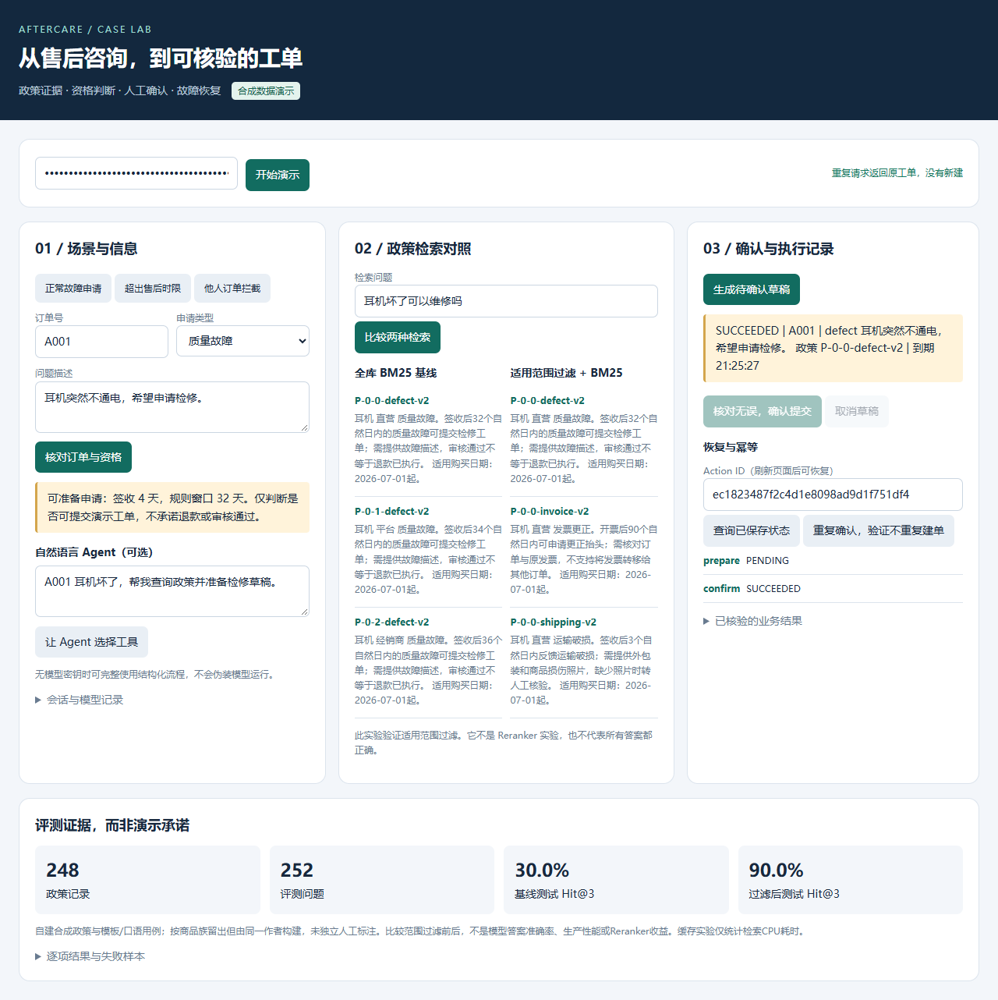
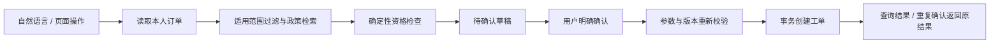

# Aftercare · 售后决策与工单工作台

[](https://github.com/solamn-1042/aftercare-agent-demo/actions/workflows/verify.yml)

**让用户从“商品坏了，能不能售后”走到“查明适用政策，确认后生成工单”。** 系统根据本人订单匹配商品、购买渠道和政策版本，解释申请条件，生成待确认草稿。用户确认后才写入工单，重复点击可返回同一结果。



## 解决什么问题

| 售后处理中的问题 | 系统如何处理 | 可以观察到的结果 |
|---|---|---|
| 同一商品存在多个渠道、多个版本的政策，文本相似却不能通用 | 先依据订单元数据过滤适用范围，再做 BM25 检索 | 页面并排显示全库检索与过滤后的政策，便于核对证据 |
| 模型可能误解用户意图或提前声称申请成功 | 模型只查询与起草，业务规则核验资格，提交须用户确认 | 形成草稿时没有工单；点击确认后才显示工单号 |
| 重复点击、并发确认或提交后响应丢失 | 持久化 Action ID、参数摘要，事务与唯一约束保护写入 | 重试返回同一工单；按 Action ID 找回结果 |
| 只看“回答像不像”难以定位失败 | 分别记录检索、业务状态、模型回复与节点日志 | 可复现版本混淆、未命中与虚构上传入口等案例 |

## 一次申请如何完成



自然语言路径使用 LangGraph 编排 4 个工具：`read_order`、`find_policy`、`check_eligibility`、`prepare_draft`。确认提交没有暴露为模型工具。无模型密钥也可在页面运行结构化业务流程。

## 快速运行

Python 3.12，在仓库根目录执行：

```powershell
python -m venv .venv
.venv\Scripts\Activate.ps1
python -m pip install -r requirements-lab.txt
Copy-Item .env.example .env
python -c "import secrets; print(secrets.token_urlsafe(32))"
# 将生成的随机串填入 .env 的 API_TOKEN
python -m uvicorn lab.app:app --env-file .env --host 127.0.0.1 --port 8001 --workers 1
```

打开 http://127.0.0.1:8001 并输入 API_TOKEN。使用 A001 体验申请；A002 为超期订单；A003 需要人工核验照片；B001 属于另一用户，当前身份无法访问。业务日期固定为 **2026-11-14**。自然语言功能另需在 `.env` 配置模型服务。

容器启动：`docker compose -f compose.lab.yaml up --build -d`。完整配置、回滚、接口验证见 [运行手册](docs/USAGE.md)，操作步骤见 [工作台使用示例](docs/DEMO.md)。

## 优化与实测

248 条合成政策、252 个问题；其中 150 条开发题、90 条有答案留出题、12 条无答案探针。下表检索实验固定 BM25、Top-3 和问题集，只比较是否预过滤商品、渠道及购买日期。

| 指标 | 全库基线 | 适用范围过滤后 |
|---|---:|---:|
| 90 条留出题 Hit@3 | 30.0% | 90.0% |
| 同一留出集 Hit@1 | 6.7% | 56.7% |
| Top-3 适用范围错误片段数 | 225 | 0 |

仍有 9 条留出题没有召回正确政策，口语表达和主题相关性是当前不足。数据由同一项目构造，结果不代表真实客户问法或生产准确率。详见 [原始检索报告](evals/lab_report.json)。

真实模型评测完成 8 个任务各 3 次，平均完整响应 **3.94 秒**，P95 **5.92 秒**；24/24 是草稿与未确认不写入的状态检查，不能解释成回答准确率 100%。首轮出现“虚构照片上传入口”，补充状态约束与回归后复测，[首轮](evals/baseline/lab_agent.json)与[复测](evals/lab_agent.json)均保留。

57 项回归覆盖旧服务 31 项及工作台 26 项，包含越权、草稿过期、版本变化、并发幂等和提交后响应丢失；另有真实 HTTP 与 Docker/CI 验证。当前 Actions 结果见页首徽章。

```sh
python -m lab.evaluate
python -m unittest discover -s tests -p 'test_lab*.py' -v
```

## 代码导航与适用范围

| 文件 | 职责 |
|---|---|
| `lab/workflow.py` | 订单、资格、草稿、确认、事务与状态恢复 |
| `lab/retrieval.py` | BM25、元数据过滤、公开证据缓存 |
| `lab/agent.py` | 模型工具循环、预算与输出约束 |
| `lab/app.py` / `lab/workbench.html` | HTTP 接口与交互工作台 |
| `lab/evaluate*.py` / `tests/test_lab*.py` | 可重复评测与异常回归 |

这是使用合成订单和政策的个人工程项目。当前身份固定为 demo-alice，SQLite 单实例；没有支付、真实人工转接、照片上传或生产多租户能力。模型循环有轮数、工具次数和请求超时限制，详见运行手册。原 BGE/Chroma RAG 服务保留为 [v1 独立实现](docs/LEGACY_V1.md)，其数据与指标不并入 v2 实验。
