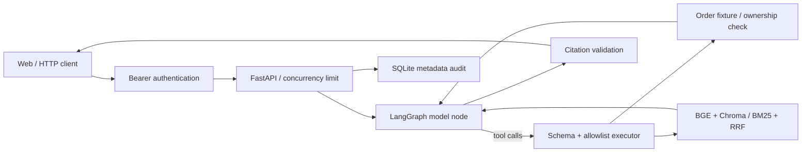

# Aftercare Agent 售后服务工程 Demo

面向订单状态与售后规则咨询的可部署 Agent 示例。模型通过两个只读工具查询合成订单、检索售后知识；LangGraph 控制模型与工具循环，FastAPI 提供鉴权、并发限制、请求追踪和审计接口。

本项目由已有售后 Agent 学习原型扩展，使用 AI 辅助工程实现与验证。订单和规则均为演示数据，不连接真实商家，不执行退款。它是可审查、可部署的工程 Demo，不声称已在企业生产环境上线。

## 架构



每次请求最多 4 次模型调用、6 次工具调用，每轮最多 2 个工具；模型超时 30 秒且不自动重试。工具名、参数和订单归属由代码检查，不能由模型授权。没有模型密钥时进入 `evidence_only` 模式，仅展示真实检索证据。

## 快速启动

要求 Python 3.12；建议至少 4 GB 可用内存。首次运行下载 `BAAI/bge-small-zh-v1.5`。依赖版本见 `requirements-service.txt`。

```powershell
python -m venv .venv
.venv\Scripts\Activate.ps1
python -m pip install -r requirements.txt
Copy-Item .env.example .env
python -c "import secrets; print(secrets.token_urlsafe(32))"
```

把生成的随机串填入 `.env` 的 `API_TOKEN`，至少 24 个字符；填写你自己的模型 API Key 和该账号可用的模型名。仓库不包含密钥。仅测试检索可留空 `DEEPSEEK_API_KEY`。

```powershell
python -m service.index
python -m uvicorn service.api:app --env-file .env --host 127.0.0.1 --port 8000 --workers 1
```

打开 `http://127.0.0.1:8000`，输入 API_TOKEN，询问“ A002 的退款状态如何？退款一般多久到账？”。页面展示回答、引用片段、节点路径和请求 ID。令牌仅保留在当前页面输入框，不写入浏览器存储。

Linux 使用 `source .venv/bin/activate`。离线环境可预先下载模型，并通过 `EMBEDDING_MODEL=/absolute/model/path` 指定本地目录。索引、模型缓存、审计文件都不纳入 Git。

## Docker 部署

```sh
cp .env.example .env
# 编辑 .env，设置随机 API_TOKEN 和可选模型配置
docker compose build
docker compose run --rm api python -m service.index
docker compose up -d
docker compose logs --tail 50 api
curl http://127.0.0.1:8000/health/ready
```

镜像使用非 root 用户，运行时只读根文件系统、移除 capabilities；数据卷保存 Chroma、模型和审计，临时文件写入 tmpfs。Compose 默认仅监听宿主机回环地址。对外部署应使用 HTTPS 反向代理和组织身份认证，将认证主体映射为订单 owner；本 Demo 只有一个固定演示主体 `demo-alice`，不能直接作为多租户系统开放。

Chroma 使用嵌入式持久化，服务按单进程部署。更新知识库时先停止 API，备份卷，运行索引任务，再启动并回归；不支持并发在线索引写入。横向扩展需改为独立 Chroma 服务及集中式鉴权、限流、会话存储。

回滚：保留上一版本镜像与数据卷备份，停止新实例，恢复匹配的数据快照后启动旧镜像。不要在服务运行期间直接复制活跃数据库文件。日志和健康探测不等于备份成功，恢复后需要重新执行 smoke 检查。

## API 与演示数据

| 入口 | 用途 | 鉴权 |
|---|---|---|
| `GET /` | 浏览器界面 | 页面公开，问答需令牌 |
| `GET /health/live` | 存活探测 | 无 |
| `GET /health/ready` | 索引和模型初始化完成 | 无 |
| `POST /v1/ask` | `{ "question": "A001发货了吗？" }` | Bearer |
| `GET /v1/metrics` | 状态计数与平均耗时 | Bearer |

```sh
curl http://127.0.0.1:8000/v1/ask \
  -H "Authorization: Bearer $API_TOKEN" \
  -H "Content-Type: application/json" \
  -d '{"question":"A001发货了吗？"}'
```

当前用户可查询 A001（机械键盘，已发货）、A002（蓝牙耳机，退款中）。B001 属于另一演示用户，会被拒绝；不存在与无权访问返回同一错误。工具不返回客户标识，也不允许调用者提供或覆盖 owner。

结果状态包含 `answered`、`refused`、`evidence_only`、`provider_error`、`budget_exhausted`。`answered` 只表示通过本次引用来源校验，不代表事实质量通过人工验收。HTTP 401 表示令牌错误，422 表示参数不合格，413 表示正文超过 16 KiB，429 表示两个并发执行槽均被占用；模型故障通过结构化状态返回。

## 实测与复现

```sh
python -m unittest discover -s tests -v
python evaluate.py
# 显式加载自己的模型环境变量后运行完整模型评测
python -c "from dotenv import load_dotenv; load_dotenv(); from evaluate import main; main(True)"
```

固定 60 条自建题：40 条政策、10 条订单、10 条异常/越权/无依据请求。检索评测只统计 40 条有政策证据的问题，要求 Top-3 包含标注的正文片段；订单题不能混入检索命中率分母。

2026-11-14 Windows 本机、BGE-small-zh-v1.5、14 个知识片段实测：向量、BM25、混合检索均为 40/40。混合检索平均 11.97 ms、P95 14.09 ms，不含首次加载。小规模、同源自建测试集不能证明混合检索普遍优于单路检索，因此不报告虚假的提升幅度。

DeepSeek `deepseek-v4-flash` 完整 60 题、并发 2 的真实评测：50 条正向问题均出现预期工具调用（50/50），平均端到端耗时约 1.90 秒。51 条返回带引用回答、9 条拒答；其中一条异常题正确说明无法确定到账时刻并给出一般规则，所以不能把 `answered` 状态当作安全失败。详细逐题记录、耗时、调用路径与数据摘要见 `evals/agent.json`。

首轮结果保留在 `evals/baseline/agent.json`。修复了占位订单引用未拦截的问题，并收紧模型对查询能力的描述。剩余措辞边界和审核结果见 [评测说明](docs/EVALUATION.md)。本项目没有声称“回答准确率 100%”。

CI 在每次提交执行离线回归和容器构建/真实 Embedding smoke；不依赖模型密钥，也不把模拟模型测试当作真实 LLM 测试。实际 CI 结果应以当前提交的 Actions 状态为准。

## 工程边界

- 审计仅保存随机请求 ID、状态、时间和耗时，写入时清理 7 天前记录；不保存问题、回答、工具参数、订单内容或 API Key。审计写入失败会告警，业务仍可返回。
- 令牌为单主体 Demo 身份，缺少账号系统、全局限流、TLS 终止、多租户隔离、分布式会话、全链路 tracing；不宣称高可用或生产 SLA。
- 接口是无状态单轮请求。原学习原型的进程内多轮记忆未作为线上会话实现发布，避免跨用户共享历史。
- 引用校验验证 ID 来源，不能证明每句自然语言都被证据蕴含。模型仍可能把运费规则扩展为退货资格判断；需人工复核或进一步采用结构化答案/逐句证据审核。
- BM25 降级会明确标识，因缺乏语义证据而拒绝生成；不把 RRF 分数当成余弦相似度。阈值 0.35 是演示配置，并非校准过的置信度。
- 两个工具均为只读。没有 Shell、支付、退款执行或自动转人工能力。模型输出中声称已执行操作不具有业务效力。

## 目录与参考

`service/ticket_engine.py`：LangGraph 模型/工具循环；`service/engine.py`：检索和无密钥模式；`service/api.py`：服务边界与审计；`retriever.py`、`vector_store.py`、`hybrid_search.py`：分块、BGE、Chroma、BM25/RRF；`tests/`：故障与权限回归；`evals/`：冻结用例与真实运行记录。

工程复用了本人学习项目中的检索组件，独立保存为售后展示工程；DevDocs 课程仓库及定时安排未修改。LangGraph API 参考 [官方 StateGraph 文档](https://reference.langchain.com/python/langgraph/graph/state/StateGraph)，向量存储参考 [Chroma Python API](https://docs.trychroma.com/reference/python)。
